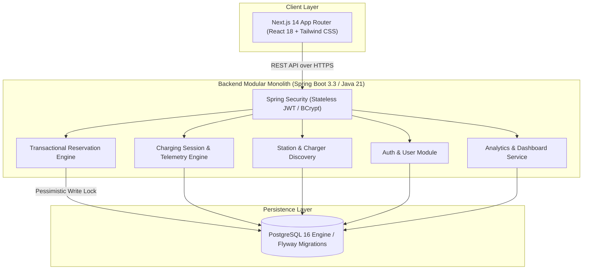

# VoltFlow — Smart EV Charging Platform

[](https://github.com/Yugenjr/hld-sd/actions/workflows/ci.yml)
[](https://adoptium.net)
[](https://spring.io/projects/spring-boot)
[](https://nextjs.org)
[](https://www.postgresql.org)
[](LICENSE)

An enterprise-grade, full-stack electric vehicle (EV) charging network platform featuring real-time station discovery, concurrency-safe charger reservations, simulated telemetry telemetry streaming, and automated billing management.

---

## ⚡ Key Highlights & Capabilities

- **Grid & Station Discovery:** Multi-parameter search across operational charging corridors with connector filters (CCS2, NACS, Type 2, CHAdeMO) and real-time kW power specs.
- **Transactional Charger Holds:** Database-level pessimistic and optimistic locking preventing race conditions and double bookings across simultaneous drivers.
- **Idempotent Reservations:** Network-retry protection utilizing client idempotency keys to ensure zero duplicate booking fees.
- **Deterministic Telemetry Simulation:** High-fidelity mathematical charging simulation advancing battery SoC (State of Charge %), energy delivered (kWh), and running costs with realistic power tapering curves.
- **Integrated Driver Dashboard:** Aggregated metrics, active session monitoring, and itemized billing statements.
- **Zero-Friction Local Run:** Standalone embedded in-memory PostgreSQL-mode for zero-dependency local runs or Docker-compose for production testing.

---

## 🏗️ High-Level System Architecture



---

## 🚀 Quickstart Guide

### Prerequisites
- Java 21+
- Node.js 18+ & npm

### 1. Start the Java Backend
```bash
# Windows
mvnw.cmd spring-boot:run

# Linux / macOS
./mvnw spring-boot:run
```
- Backend starts at: `http://localhost:8080`
- Swagger UI interactive documentation: `http://localhost:8080/swagger-ui.html`
- OpenAPI JSON specification: `http://localhost:8080/api-docs`
- Actuator Health probe: `http://localhost:8080/actuator/health`

### 2. Start the Next.js Frontend
```bash
cd frontend
npm install
npm run dev
```
- Open [http://localhost:3000](http://localhost:3000) in your web browser.

---

## 🔑 Pre-Configured Demo Credentials

The database is pre-seeded with realistic stations, chargers, and demo accounts:

| Role | Email | Password |
|---|---|---|
| **EV Driver** | `demo@smartev.com` | `Password123!` |
| **Administrator** | `admin@smartev.com` | `AdminPassword123!` |

*(The sign-in page also includes a 1-click quick login button for instant exploration).*

---

## 🧪 Testing and Verification

### Backend Automated Tests
```bash
# Run JUnit 5 Integration test suite
mvnw.cmd test
```
Covers:
- User registration, duplicate email rejection, and JWT authentication.
- Station search and filtering by power and connector.
- Pessimistic locking and race-condition conflict handling (409 Conflict).
- Idempotency key deduplication.
- Start charging session lifecycle transition and invalid status rejection.
- Live telemetry calculation (energy, battery %, running cost).
- Authorization ownership boundaries.

### Frontend Quality Checks
```bash
cd frontend
npm run typecheck    # Strict TypeScript type checking
npm run build        # Production Next.js bundle compilation
```

---

## 📂 Project Structure

```
hld-sd/
├── frontend/                     # Next.js 14 App Router frontend
│   ├── app/                      # Routes (auth, dashboard, stations, reservations, charging, history)
│   ├── components/               # Reusable UI components (Navbar, MetricCard)
│   ├── lib/                      # Typed API client and utilities
│   └── types/                    # Domain TypeScript interfaces
├── backend/                      # Spring Boot 3.3 backend modular monolith
│   ├── src/main/java/.../
│   │   ├── config/               # Security, OpenAPI, Data Initializer
│   │   ├── security/             # JWT provider, filter, UserPrincipal
│   │   ├── common/               # ApiResponse envelope, GlobalExceptionHandler
│   │   ├── user/                 # User entity, AuthService, AuthController
│   │   ├── station/              # Station entity, StationService, StationController
│   │   ├── charger/              # Charger entity, ChargerStatus, ConnectorType
│   │   ├── reservation/          # Reservation entity, Concurrency Locking, Service
│   │   ├── charging/             # Session entity, TelemetrySimulator, Service
│   │   └── dashboard/            # Aggregated Metrics Service & Controller
│   ├── src/main/resources/
│   │   ├── application.yml       # Configuration profiles (local, docker)
│   │   └── db/migration/         # Flyway V1 schema & V2 seed data
│   └── src/test/java/...         # JUnit 5 & MockMvc integration tests
├── docs/                         # System Design & Architecture documentation
│   ├── architecture.md           # High-level architecture & diagrams
│   ├── low-level-design.md       # LLD, sequence diagrams & concurrency
│   ├── api-reference.md          # REST API endpoints & payloads
│   ├── database-design.md        # Database schema & Mermaid ER diagram
│   ├── scalability-and-reliability.md # Enterprise scaling & Kafka design
│   └── deployment.md             # Operations & deployment runbook
├── infra/                        # Docker Compose infrastructure
│   └── docker-compose.yml        # PostgreSQL 16 & Redis
├── .github/workflows/            # CI/CD Workflows
└── README.md
```

---

## 📄 License
This project is open-source under the MIT License.
