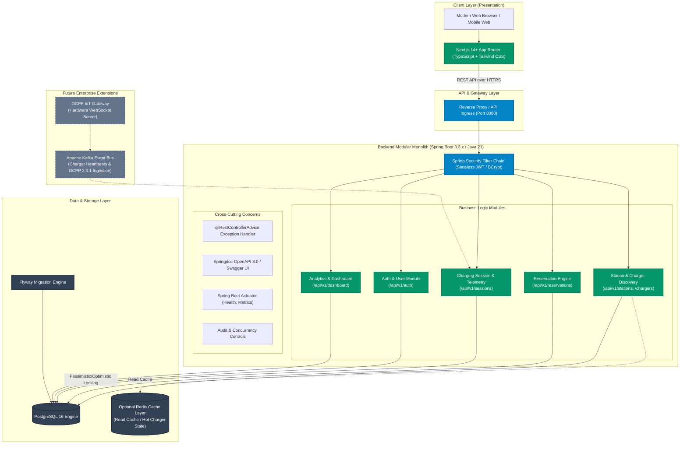
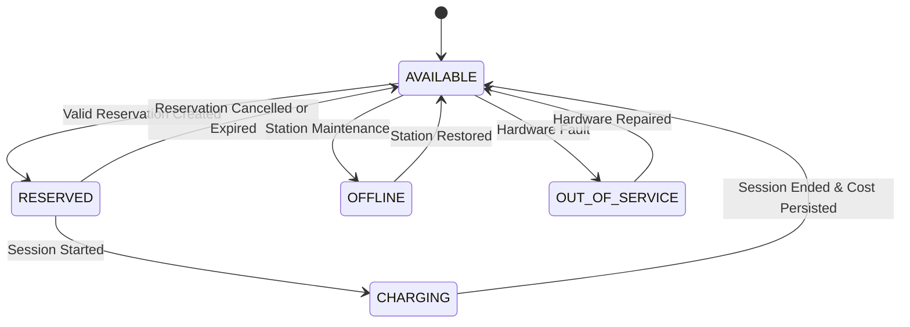
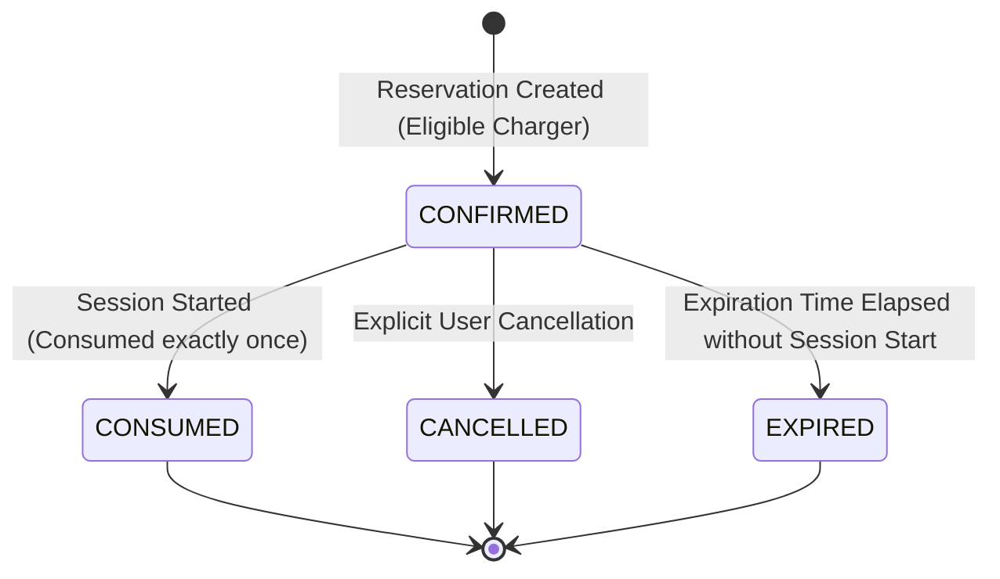
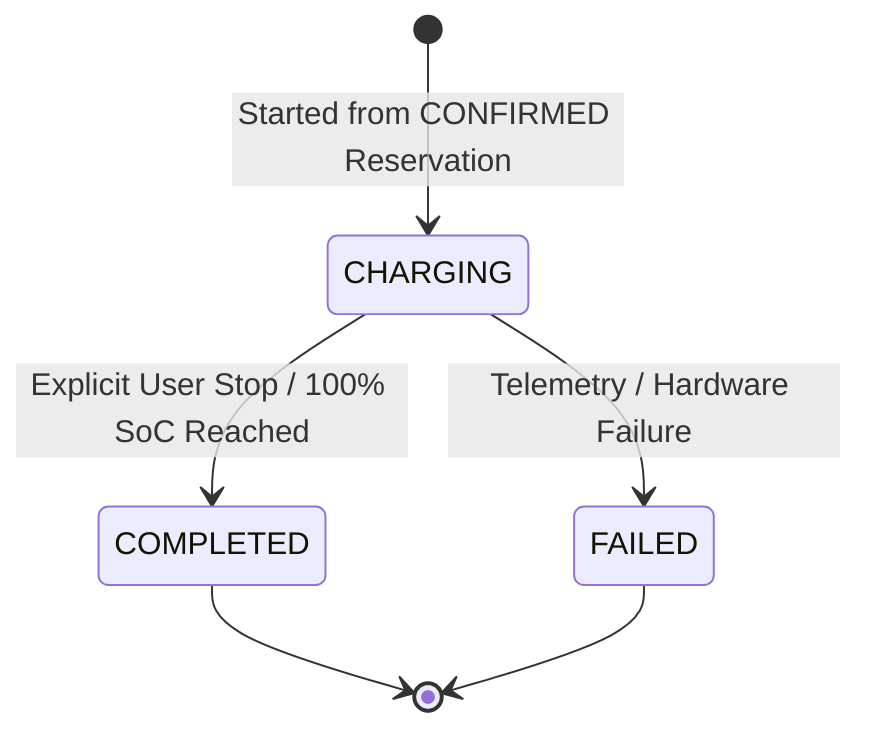

# Smart EV Charging Platform — System Architecture & Product Scope

## 1. Executive Summary & Product Scope

The **Smart EV Charging Platform** is a full-stack, enterprise-grade electric vehicle charging station reservation, telemetry monitoring, and session management platform. It addresses the real-world operational challenges of EV drivers and charging point operators (CPOs):
- Real-time station discovery with multi-faceted filtering (power rating, connector type, operational status, amenities).
- Concurrency-safe charger reservation to eliminate arrival contention and charger "range anxiety".
- End-to-end charging session management with live telemetry calculation (energy in kWh, state of charge %, elapsed duration, running cost).
- Centralized user dashboard aggregating usage analytics, real-time status indicators, and historical charging invoices.
- Strict state-machine enforcement preventing race conditions, double reservations, or invalid session transitions.

---

## 2. High-Level System Architecture Diagram

---

## 3. Component Architecture & Layered Responsibilities

| Layer | Technology | Responsibilities |
|---|---|---|
| **Frontend UI** | Next.js 14, React 18, Tailwind CSS, Lucide Icons | Responsive UI, state management, form validation (Zod / Hook Form), client-side telemetry animation, session timers. |
| **Security & Auth** | Spring Security 6, JJWT, BCrypt | Token issuance, request authentication, role-based authorization, resource ownership enforcement. |
| **REST Controllers** | Spring Web MVC | Input validation (`@Valid`), HTTP status mapping, standardized error envelope formatting. |
| **Service Domain** | Spring `@Service` Beans | Business invariants, transactional boundaries (`@Transactional`), deterministic charging simulation, state machines. |
| **Data Access** | Spring Data JPA, Hibernate, Flyway | Versioned database schema migrations, query optimization, composite indexes, concurrency locking (`@Version`). |
| **Primary Database** | PostgreSQL 16 (or H2 in Postgres mode for zero-dependency local runs) | ACID transactional consistency, unique constraints, foreign keys, deterministic timestamping. |

---

## 4. State Machines & Lifecycle Invariants

### 4.1 Charger State Machine

### 4.2 Reservation State Machine

### 4.3 Charging Session State Machine

---

## 5. Security Architecture

1. **Authentication:** Stateless Bearer Token (JWT) issued on `POST /api/v1/auth/login` or `POST /api/v1/auth/register`.
2. **Password Security:** Salted BCrypt (work factor 12) prevents brute-force rainbow table attacks.
3. **Authorization & Ownership:** Every user-specific endpoint (`/reservations/{id}/cancel`, `/reservations/{id}/start`, `/sessions/{id}/end`) verifies that the requesting `userId` matches the record owner or possesses `ROLE_ADMIN`.
4. **Idempotency:** Unique `idempotencyKey` provided in reservation creation headers/payload prevents double billing or duplicate booking on network retries.
5. **No Credential Leakage:** Entity models are never returned directly; specialized Data Transfer Objects (DTOs) sanitize sensitive attributes.
