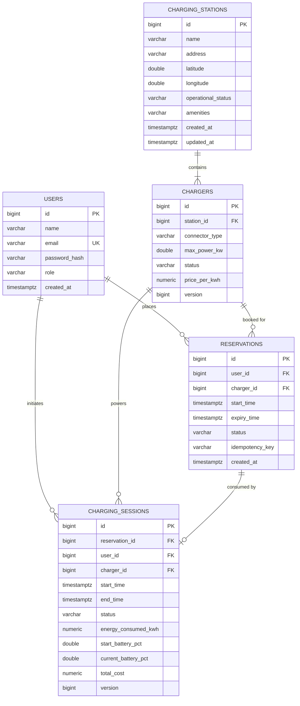

# Smart EV Charging Platform — Database Design

## 1. Entity-Relationship (ER) Diagram

---

## 2. Table Specifications & Constraints

### 2.1 `users`
- `id`: Auto-incrementing primary key.
- `email`: Enforces case-insensitive uniqueness (`UNIQUE`).
- `password_hash`: Salted BCrypt (60 chars). Never exposed in API responses.
- `role`: `ROLE_USER` or `ROLE_ADMIN`.

### 2.2 `charging_stations`
- `operational_status`: `OPERATIONAL`, `MAINTENANCE`, `CLOSED`.
- Indexed on `operational_status` for fast active station filtering.
- Bounded spatial queries on `(latitude, longitude)`.

### 2.3 `chargers`
- `connector_type`: `CCS2`, `NACS`, `CHADEMO`, `TYPE2`.
- `status`: `AVAILABLE`, `RESERVED`, `CHARGING`, `OFFLINE`, `OUT_OF_SERVICE`.
- `version`: Long integer used by JPA `@Version` for optimistic concurrency protection.
- Indexed on `(station_id, status)`.

### 2.4 `reservations`
- `status`: `CONFIRMED`, `CANCELLED`, `EXPIRED`, `CONSUMED`.
- `idempotency_key`: Optional client token preventing double bookings across network retries.
- Foreign keys: Restrict deletion on active users or chargers.

### 2.5 `charging_sessions`
- `status`: `CHARGING`, `COMPLETED`, `FAILED`.
- `energy_consumed_kwh`: Numeric precision (10, 3) for milliwatt-hour precision.
- `total_cost`: Numeric precision (10, 2) in local currency (USD).
- `version`: Optimistic lock field ensuring concurrent telemetry writes never collide.

---

## 3. Migration Strategy
Flyway manages schema lifecycle under `classpath:db/migration`:
- `V1__init_schema.sql`: Table definitions, foreign key constraints, and performance indexes.
- `V2__seed_demo_data.sql`: Seed data for stations, chargers, and pre-seeded demo accounts (`demo@smartev.com`, `admin@smartev.com`).
