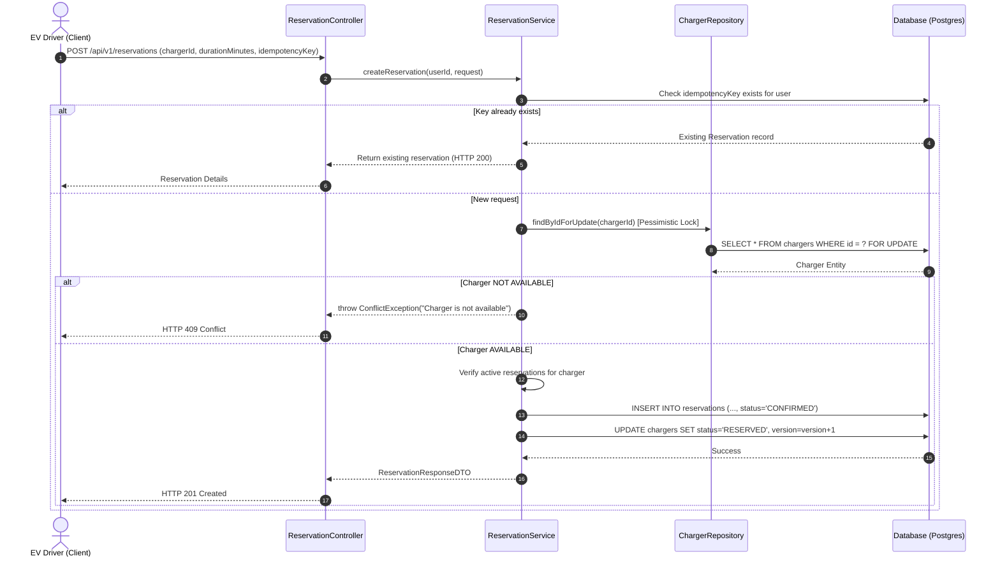
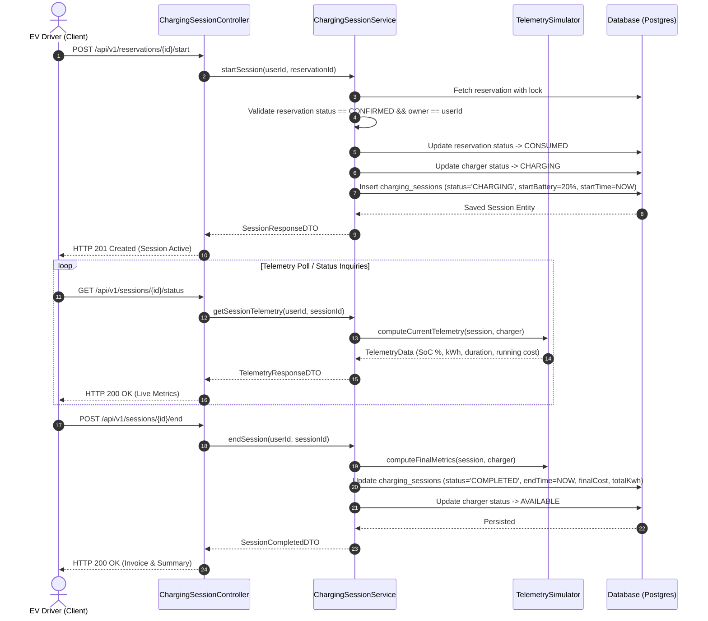

# Smart EV Charging Platform — Low-Level Design (LLD)

## 1. Domain Modeling and Class Hierarchy

The platform implements a clean Domain-Driven Modular Monolith pattern within `backend/src/main/java/com/smartev/platform`:

```
com.smartev.platform/
├── config/             # OpenAPI, WebMvc CORS, Jackson, Caching configuration
├── security/           # JwtTokenProvider, JwtAuthenticationFilter, SecurityConfig
├── common/             # ApiResponse envelope, GlobalExceptionHandler, ErrorCode, BaseEntity
├── user/               # User entity, UserRepository, UserService, AuthController, UserDTOs
├── station/            # ChargingStation entity, Repository, Service, StationController
├── charger/            # Charger entity, ChargerStatus, ConnectorType, ChargerRepository
├── reservation/        # Reservation entity, ReservationStatus, Service, ReservationController
├── charging/           # ChargingSession entity, SessionStatus, TelemetrySimulator, SessionController
└── dashboard/          # DashboardService, DashboardMetricsDTO, DashboardController
```

---

## 2. Concurrency and Locking Strategy

### 2.1 Charger Race Condition Prevention
When multiple users attempt to reserve the same charger concurrently, data consistency is strictly preserved using **Optimistic Locking with JPA `@Version`** and **Pessimistic Write Locks (`LockModeType.PESSIMISTIC_WRITE`)** during state transitions:

```java
@Lock(LockModeType.PESSIMISTIC_WRITE)
@Query("SELECT c FROM Charger c WHERE c.id = :id")
Optional<Charger> findByIdForUpdate(@Param("id") Long id);
```

### 2.2 Idempotency Key Handling
1. The client supplies an optional or generated `idempotencyKey` UUID upon calling `POST /api/v1/reservations`.
2. The `Reservation` table enforces a database-level unique constraint on `(user_id, idempotency_key)`:
   ```sql
   CREATE UNIQUE INDEX idx_reservation_user_idempotency 
   ON reservations (user_id, idempotency_key) 
   WHERE idempotency_key IS NOT NULL;
   ```
3. If a duplicate request is received within the retry window, the existing reservation is returned with HTTP 200 rather than re-reserving or erroring out.

---

## 3. Telemetry Simulation Engine

In industrial EV charging networks, chargers stream telemetry over OCPP (Open Charge Point Protocol) via WebSockets. To provide a high-fidelity local experience without external hardware, the platform employs a **Deterministic Mathematical Telemetry Simulator**:

$$\Delta t = \text{currentTime} - \text{startTime}$$
$$\text{energyDelivered} = \min\left(\text{batteryCapacity} \times (1 - \text{startSoC}), \text{maxPowerKw} \times \frac{\Delta t}{3600}\right)$$
$$\text{currentBatteryPct} = \min\left(100.0, \text{startBatteryPct} + \frac{\text{energyDelivered}}{\text{batteryCapacity}} \times 100\right)$$
$$\text{totalCost} = \text{energyDelivered} \times \text{pricePerKwh}$$

- **Non-drift:** Telemetry state is calculated on-demand from deterministic timestamps and stored parameters, ensuring consistency across page refreshes and server reboots.
- **Hardware Agnostic:** A future OCPP 2.0.1 WebSocket gateway can replace the simulation engine without changing REST endpoints or frontend contracts.

---

## 4. Sequence Diagrams

### 4.1 Reservation Creation Sequence


### 4.2 Charging Session Lifecycle Sequence

