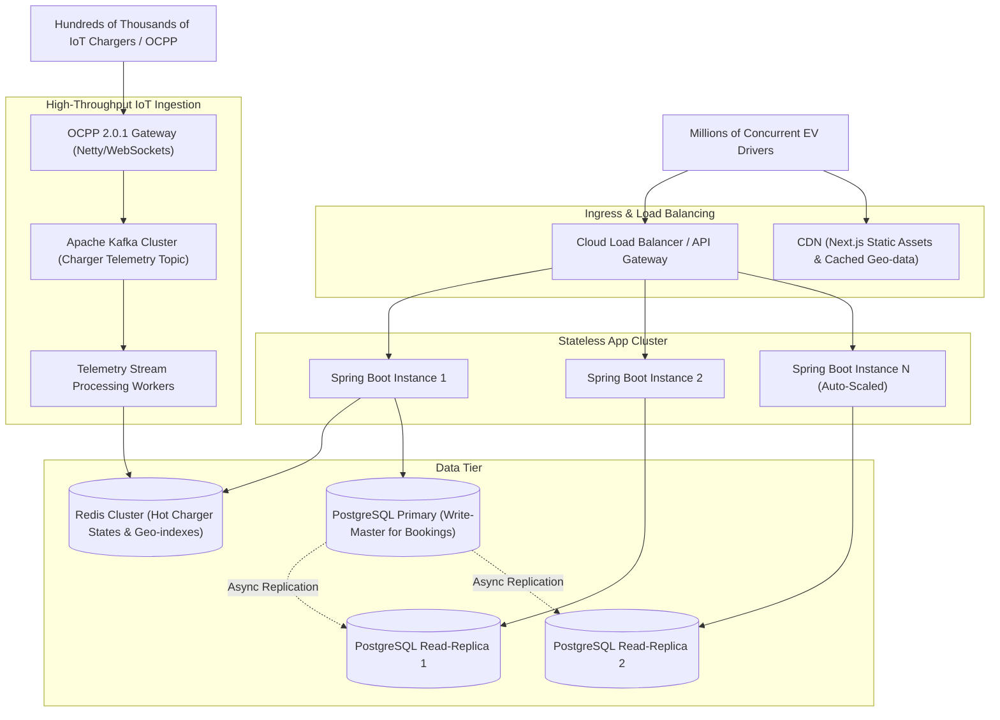

# Smart EV Charging Platform — Scalability & Reliability Design

## 1. Architectural Scaling Dimensions



---

## 2. High-Throughput Booking & Concurrency Protection

### 2.1 The Two-Phase Booking Challenge
In EV charging, physical chargers represent scarce physical resources. Contention spikes occur during commute hours and around major highway arteries.
- **Problem:** If two drivers query station availability simultaneously, both may observe Charger #1 as `AVAILABLE`.
- **Solution:** Pessimistic lock (`SELECT ... FOR UPDATE`) within a `READ_COMMITTED` transaction boundary ensures that only one driver acquires the reservation. The second transaction immediately detects `status == RESERVED` and gracefully returns HTTP 409 Conflict.
- **Optimistic Concurrency Fallback:** The JPA `@Version` column on the `Charger` table provides secondary protection across distributed instances:
  ```java
  @Version
  private Long version;
  ```

---

## 3. High-Frequency Telemetry Ingestion Architecture

Currently, local simulation computes metrics on-demand using mathematical physics formulas. In scaled production:
1. Chargers transmit heartbeats and meter readings every 10–30 seconds via OCPP 2.0.1 WebSockets.
2. Ingestion is partitioned across Kafka topics keyed by `station_id`:
   - `Partition = hash(station_id) % num_partitions`
3. In-memory hot state (current SoC, active kW, meter reading) is stored in Redis key-value hashes (`charger:{id}:state`).
4. Only persistent lifecycle milestones (session start, 15-minute billing summaries, session end) are written to PostgreSQL, reducing write load by 98%.

---

## 4. Fault Tolerance & Resilience Patterns

| Pattern | Implementation | Benefit |
|---|---|---|
| **Idempotency Keys** | Client UUIDs in `POST /reservations` | Prevents duplicate bookings or accidental multiple charges during mobile network reconnects. |
| **Health Checks** | Spring Boot Actuator (`/actuator/health`) | Probes container liveness and database connection readiness before routing traffic. |
| **Connection Pooling** | HikariCP with bounded minimum/maximum connections | Guarantees database responsiveness without thread exhaustion. |
| **Circuit Breakers** | Resilience4j / Sentinel for payment & external grid integrations | Prevents cascading failures when third-party utility APIs degrade. |
| **Scheduled Auto-Cleanup** | Spring `@Scheduled` background worker | Automatically sweeps and expires abandoned bookings, preventing charger hoarding. |
